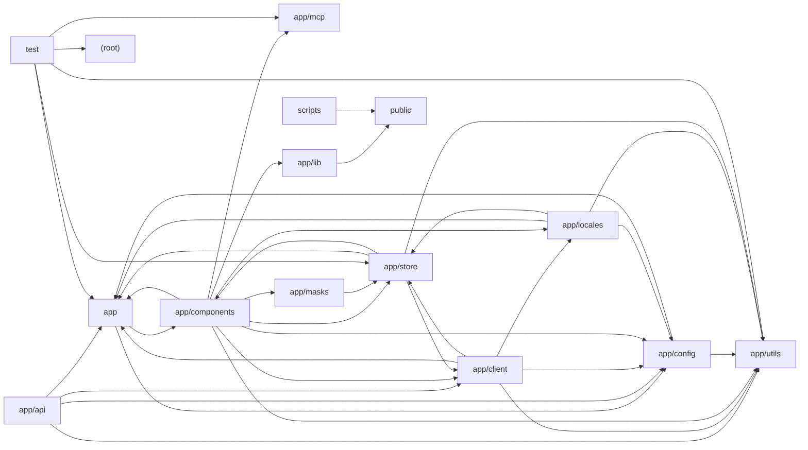

# Architecture

NextChat is a Next.js (App Router) multi-provider LLM chat client that can be deployed as a web app, standalone server, static export, or Tauri desktop app. The architecture is layered: the root `app` module supplies constants (provider URLs, paths, storage keys), typings, and shared utilities; `app/config` resolves build-, client-, and server-side configuration from environment variables and meta tags; `app/api` is a server-side proxy layer (declared as Edge runtime despite the stack listing Node) that authenticates access codes, injects server API keys, enforces model allow-lists, and forwards streaming requests to 15+ providers plus WebDAV/Upstash/Cloudflare KV persistence endpoints; `app/client` is the browser-side adapter layer implementing a common `LLMApi` interface per provider (OpenAI/Azure, Anthropic, Gemini, DeepSeek, Qwen, Ernie, Doubao, Hunyuan, Spark, Moonshot, Grok, GLM, SiliconFlow, 302.AI) with SSE streaming, tool calls, TTS, and image/video generation; `app/store` holds persistent Zustand state (sessions, masks, plugins, prompts, SD tasks, sync, access credentials) backed by IndexedDB via `app/utils`; `app/components` renders the full UI (chat, markdown/artifacts, settings, masks, plugins, MCP market, realtime voice, Stable Diffusion); `app/mcp` manages Model Context Protocol stdio servers via server actions; `app/locales` and `app/masks` supply i18n dictionaries and built-in prompt templates; `app/lib` and `public` provide Web Audio and Service Worker infrastructure; `scripts` and `test` cover prompt bundling and Jest unit coverage. Notable open issues: an edge/node runtime mismatch in API routes, in-memory MCP client maps that may not survive serverless scaling, a WAV blob mislabeled as audio/mpeg, a Tencent env-var name mismatch, and a sync merge bug reading `localState.lastUpdateTime` in place of the remote timestamp.

## Modules

| module | summary | AI |
| --- | --- | --- |
| `(root)` | Prettier, Jest/jsdom, and Next.js build configuration including webpack SVG loaders, CORS headers, and proxy rewrites to LLM provider endpoints. | [AI] |
| `app` | Root Next.js shell with layout, home page, global constants for AI providers and routes, command hooks, typings, and shared utilities. | [AI] |
| `app/api` | Edge-runtime API proxy and auth layer that validates access codes, injects server keys, filters models, and streams requests to LLM providers plus backup endpoints. | [AI] |
| `app/client` | Unified client-side LLMApi adapters per provider handling streaming chat, tool calls, TTS, image/video generation, and abort-controller pooling. | [AI] |
| `app/components` | React UI for chat, markdown/artifact rendering, settings, masks, plugins, MCP market, realtime voice, Stable Diffusion, and design-system primitives. | [AI] |
| `app/config` | Build-time, client-side, and server-side configuration loaders for provider keys, model rules, access codes, and build metadata. | [AI] |
| `app/lib` | AudioHandler wrapping the Web Audio API for microphone capture, streaming PCM playback, frequency analysis, and WAV export. | — |
| `app/locales` | i18n dictionaries for 20+ languages with English fallback merging, language persistence, and STT language mapping. | [AI] |
| `app/masks` | Built-in prompt templates (masks) in CN/TW/EN with default model configs, bundled to public/masks.json and loaded at runtime. | [AI] |
| `app/mcp` | Server actions and SDK wrapper managing Model Context Protocol stdio servers, tool discovery, and tool execution for LLM agents. | — |
| `app/store` | Persistent Zustand stores for chat sessions, provider credentials, model config, masks, plugins, prompts, SD tasks, sync, and updates. | [AI] |
| `app/utils` | Core helpers for SSE streaming, multimodal preprocessing, model table resolution, IndexedDB persistence, cloud sync, provider signing, and TTS. | [AI] |
| `public` | AudioWorklet recorder processor and a Service Worker providing a Cache-API-backed /api/cache file store. | — |
| `scripts` | Build script fetching and curating community prompt templates into public/prompts.json. | [AI] |
| `test` | Jest unit tests for model helpers, token estimation, config validators, message parsing, vision detection, and MCP authorization. | [AI] |

## Module dependencies

_`[AI]` marks modules with AI/LLM touchpoints (prompt files, model API calls, agent logic)._
