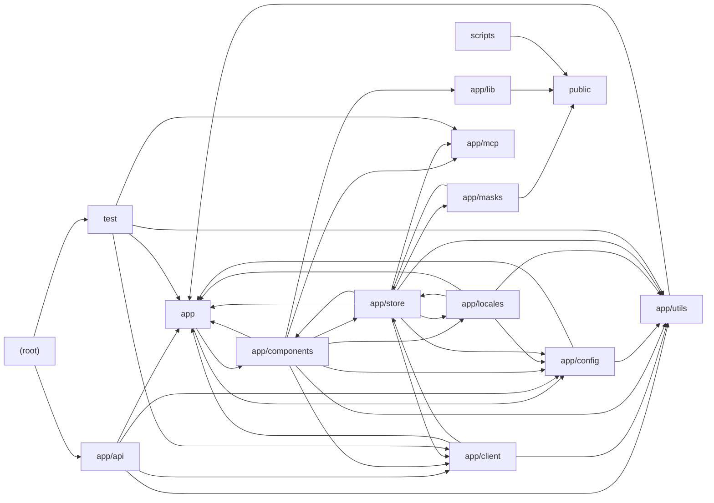

# Architecture

NextChat is a Next.js (App Router) web and Tauri desktop client for many LLM providers (OpenAI/Azure, Anthropic, Google Gemini, DeepSeek, Alibaba, Baidu, ByteDance, Moonshot, Tencent, iFlytek, xAI, ChatGLM, SiliconFlow, 302.AI, Stability). The browser UI in app/components drives Zustand persistent stores (app/store) that call a provider-agnostic client layer (app/client, LLMApi/ClientApi) which streams completions either directly or through Edge API proxy routes in app/api that authenticate with access codes and inject server-held keys from app/config. Cross-cutting helpers live in app/utils (stream orchestration, tool calls, model catalog, signing, sync, TTS), prompt templates come from app/masks and scripts, i18n from app/locales, and MCP tool servers are managed via server actions in app/mcp. Root config handles proxy rewrites, Jest, and formatting; public/ hosts the service worker and AudioWorklet; test/ covers utils, model helpers, crypto, and MCP guards. Notable tension: route handlers declare runtime 'edge' although the stack lists node.

## Modules

| module | summary | AI |
| --- | --- | --- |
| `(root)` | Next.js build/runtime config with AI-provider proxy rewrites, Jest setup, and Prettier rules. | [AI] |
| `app` | Root layout/page, shared constants (providers, paths, store keys), common types, utils, and slash-command hooks. | [AI] |
| `app/api` | Edge route handlers proxying and authenticating requests to each LLM provider plus WebDAV/Upstash/KV sync endpoints. | [AI] |
| `app/client` | Client-side LLMApi abstraction, ClientApi factory, per-provider implementations, and stream abort controller pool. | [AI] |
| `app/components` | React UI: chat, sidebar, settings, masks, plugins, MCP market, markdown/artifacts, realtime voice, and Stability image panel. | [AI] |
| `app/config` | Build, client (meta tag), and server (env var) configuration resolution for providers, keys, and access control. | [AI] |
| `app/lib` | AudioHandler for AudioWorklet recording, PCM streaming playback, frequency analysis, and WAV export. | — |
| `app/locales` | i18n dictionaries for 20+ languages with English fallback merging, persistence, and STT language mapping. | [AI] |
| `app/masks` | Builtin prompt templates (EN/CN/TW) with model configs, built into public/masks.json and loaded at runtime. | [AI] |
| `app/mcp` | Model Context Protocol server actions, stdio client lifecycle, tool discovery/execution, and MCP JSON extraction. | — |
| `app/store` | Zustand persistent stores for chat, access credentials, config, masks, plugins, prompts, SD tasks, sync, and updates. | [AI] |
| `app/utils` | Stream orchestration, tool calls, image preprocessing, model catalog logic, signing, storage adapters, sync clients, TTS. | [AI] |
| `public` | AudioWorklet processor and service worker for client-side file caching. | — |
| `scripts` | Node script aggregating remote prompt collections into public/prompts.json. | [AI] |
| `test` | Jest suite for utils, model helpers, vision detection, crypto, adapters, and MCP action guards. | [AI] |

## Module dependencies

_`[AI]` marks modules with AI/LLM touchpoints (prompt files, model API calls, agent logic)._
