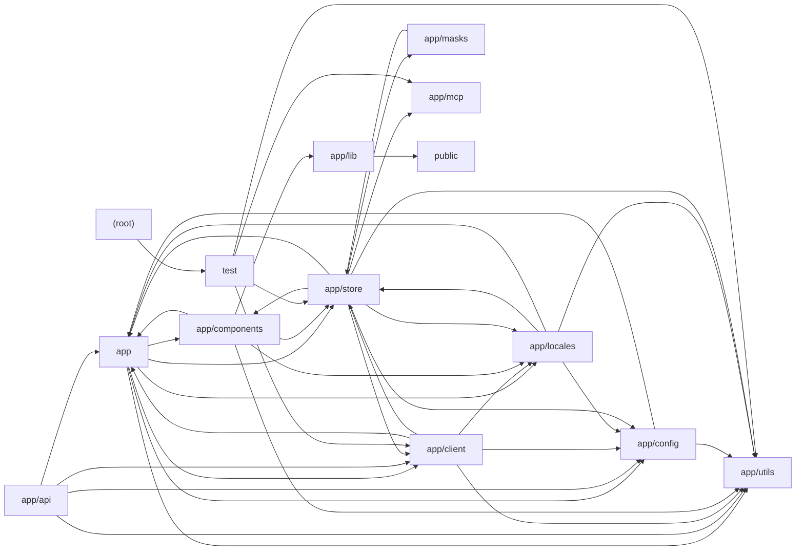

# Architecture

NextChat is a Next.js (App Router) web and Tauri desktop client for many LLM/AI providers. The browser-side layer (app/components, app/store, app/client, app/utils) renders the chat UI, persists state in IndexedDB via Zustand stores, and streams completions from provider-specific LLMApi implementations with tool calling, TTS, realtime audio and image generation. Requests are routed through Edge API handlers in app/api (or next.config.mjs rewrites) which validate access codes, inject server-side keys from app/config/server, and proxy to OpenAI, Azure, Anthropic, Google, DeepSeek, Alibaba, Baidu, ByteDance, Tencent, Moonshot, iFlytek, xAI, ChatGLM, SiliconFlow, 302.AI and Stability. Supporting modules provide i18n dictionaries (app/locales), built-in prompt personas (app/masks), Model Context Protocol server management (app/mcp), Web Audio handling (app/lib, public), prompt bundling scripts, and a Jest test suite covering utilities, validators and MCP safeguards.

## Modules

| module | summary | AI |
| --- | --- | --- |
| `(root)` | Next.js, Jest and Prettier configuration including provider reverse-proxy rewrites and CORS headers. | [AI] |
| `app` | Root layout/page, global constants (provider URLs, routes, storage keys), core types, polyfills, chat commands and shared utilities. | [AI] |
| `app/api` | Edge route handlers that authenticate, filter and proxy requests to LLM/image providers plus config, artifacts, Upstash and WebDAV endpoints. | [AI] |
| `app/client` | Client-side LLMApi abstraction, ClientApi factory and per-provider streaming chat/speech/tool-calling implementations. | [AI] |
| `app/components` | React UI: chat view, sidebar, masks, settings, plugins, MCP market, markdown/artifacts rendering, realtime voice chat and Stable Diffusion panel. | [AI] |
| `app/config` | Build, client and server configuration resolution including multi-provider API keys and model flags from env vars. | [AI] |
| `app/lib` | AudioHandler class for microphone capture, streaming PCM playback, frequency analysis and WAV export. | — |
| `app/locales` | i18n dictionaries for 20+ languages with English fallback merging, language detection and STT language mapping. | [AI] |
| `app/masks` | Built-in prompt personas in EN/CN/TW with build script producing public/masks.json and runtime loader. | [AI] |
| `app/mcp` | Model Context Protocol server lifecycle, stdio client transport, tool discovery/execution and MCP JSON extraction. | — |
| `app/store` | Zustand persisted stores for access keys, chat sessions, config, masks, plugins, prompts, SD tasks, sync and updates. | [AI] |
| `app/utils` | Streaming/tool-call loop, model catalog resolution, image preprocessing, cloud sync, IndexedDB persistence, TTS, signing and Tauri bridges. | [AI] |
| `public` | Static AudioWorklet processor and Service Worker scripts for audio capture and local /api/cache file storage. | — |
| `scripts` | Script fetching and bundling community prompt templates into public/prompts.json. | [AI] |
| `test` | Jest suites for utilities, config validators, model helpers, crypto, client adapters and MCP security gates. | [AI] |

## Module dependencies

_`[AI]` marks modules with AI/LLM touchpoints (prompt files, model API calls, agent logic)._
