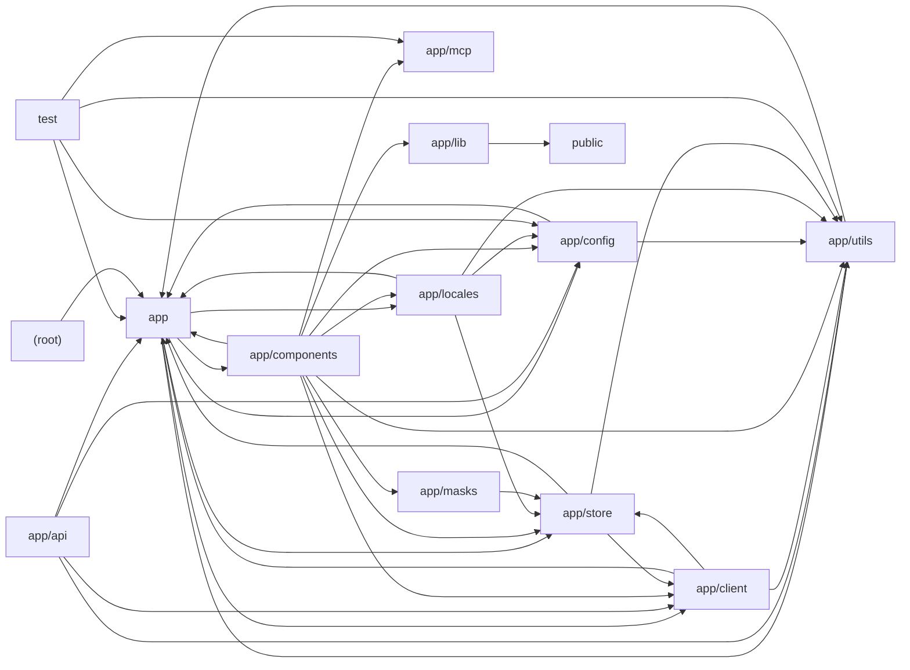

# Architecture

NextChat is a Next.js (App Router) web and Tauri desktop client for many LLM providers. The browser-side `app/client` layer exposes a unified `LLMApi` abstraction with per-provider implementations (OpenAI/Azure, Anthropic, Google Gemini, DeepSeek, Alibaba, Baidu, ByteDance, Tencent, Moonshot, iFlytek, xAI, ChatGLM, SiliconFlow, 302.AI) that stream responses via SSE helpers in `app/utils`. Requests are routed through Edge route handlers in `app/api` (a dynamic `app/api/[provider]/[...path]` dispatcher plus per-provider handlers) which authenticate access codes, inject server-side API keys from `app/config/server.ts`, filter models, and proxy to upstream providers; `next.config.mjs` additionally defines rewrite-based proxies. Client state (chat sessions, access credentials, model config, masks, prompts, plugins, Stable Diffusion tasks, sync) lives in Zustand stores (`app/store`) persisted to IndexedDB, with cloud sync via WebDAV/Upstash. `app/components` renders the UI (chat, markdown/artifacts/mermaid, settings, mask editor, plugin/MCP marketplaces, realtime voice chat, SD image generation), supported by `app/lib` audio handling, `public` service-worker and AudioWorklet scripts, `app/locales` i18n, `app/masks` built-in personas, and `app/mcp` Model Context Protocol server actions. Build scripts compile masks and community prompts into static JSON; Jest tests cover utilities, model parsing, token estimation, and MCP actions.

## Modules

| module | summary | AI |
| --- | --- | --- |
| `(root)` | Project configuration: Next.js build/bundler settings, LLM provider proxy rewrites, Prettier, and Jest setup. | [AI] |
| `app` | Root Next.js layout/page entry points plus global constants, command hooks, shared types, polyfills, and cross-platform utilities. | [AI] |
| `app/api` | Edge route handlers that authenticate, filter, and proxy requests to LLM providers and auxiliary services (artifacts KV, Upstash, WebDAV, config). | [AI] |
| `app/client` | Unified client-side LLMApi abstraction with per-provider implementations, request formatting, streaming, and abort-controller pooling. | [AI] |
| `app/components` | React UI for chat, markdown/artifacts, masks, settings, plugins, MCP marketplace, realtime voice chat, and Stable Diffusion image generation. | [AI] |
| `app/config` | Build-time, client-side, and server-side configuration including environment variables and provider API keys. | [AI] |
| `app/lib` | Web Audio API wrapper for recording, streaming playback, frequency analysis, and WAV encoding. | — |
| `app/locales` | i18n dictionaries and language detection/switching with English fallbacks and STT language mappings. | [AI] |
| `app/masks` | Built-in persona/system-prompt definitions per language and a build script compiling them to public/masks.json. | [AI] |
| `app/mcp` | Model Context Protocol client wrapper, server actions, types, logging, and tool-call JSON extraction. | — |
| `app/store` | Zustand persisted stores for chat sessions, access credentials, app config, masks, prompts, plugins, SD tasks, sync, and updates. | [AI] |
| `app/utils` | Helpers for model list resolution, SSE chat streaming and tool calls, image processing, IndexedDB persistence, cloud sync, provider signing, and TTS. | [AI] |
| `public` | Static browser runtime scripts: service worker file cache and AudioWorklet recorder processor. | — |
| `scripts` | Node script fetching and sanitizing community prompt lists into public/prompts.json. | [AI] |
| `test` | Jest unit/regression tests for utilities, model parsing, token estimation, config, and MCP actions. | [AI] |

## Module dependencies

_`[AI]` marks modules with AI/LLM touchpoints (prompt files, model API calls, agent logic)._
