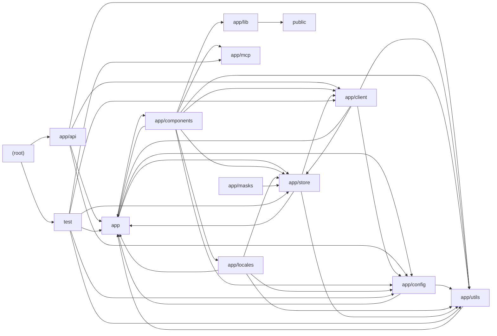

# Architecture

NextChat is a Next.js (App Router) web/desktop client for many LLM providers. The browser-side UI (app/components) is driven by Zustand stores persisted to IndexedDB (app/store, app/utils/store) and talks to providers through a client adapter layer (app/client) that normalizes chat, streaming, tool-calling, speech and image generation across OpenAI, Azure, Anthropic, Gemini, DeepSeek, Qwen, Ernie, Hunyuan, GLM, Moonshot, Spark, xAI, SiliconFlow and 302.AI. Requests go through edge route handlers in app/api, which authenticate access codes, inject server-held API keys from app/config/server, enforce model/path allow-lists, and proxy to upstream providers (optionally via Cloudflare AI Gateway); next.config.mjs adds additional rewrite-based proxies and CORS headers. Cross-cutting concerns include i18n dictionaries (app/locales), builtin prompt presets (app/masks, scripts/fetch-prompts.mjs), Model Context Protocol tool execution via server actions (app/mcp), realtime voice chat built on Web Audio worklets (app/lib, public), cloud sync via WebDAV/Upstash (app/utils/cloud), and a Jest/jsdom test suite (test) covering model helpers, token estimation, MCP guards and config parsing. Note: route handlers declare runtime='edge' despite documentation describing a node runtime.

## Modules

| module | summary | AI |
| --- | --- | --- |
| `(root)` | Next.js, Jest and Prettier configuration including CORS headers and rewrite proxies to upstream AI providers. | [AI] |
| `app` | Root layout/page, global constants (providers, endpoints, paths), chat command hooks, shared types and core utility helpers. | [AI] |
| `app/api` | Edge route handlers that authenticate, filter and proxy requests to 16+ AI providers plus WebDAV/Upstash/KV helpers. | [AI] |
| `app/client` | Client-side LLM abstraction (ClientApi/LLMApi) with per-provider adapters for chat streaming, tools, speech and images. | [AI] |
| `app/components` | React UI: chat, sidebar, masks, settings, plugins, MCP market, markdown/artifacts, realtime voice chat and Stable Diffusion views. | [AI] |
| `app/config` | Build, client (meta-tag) and server (env var) configuration readers including per-provider keys and URLs. | [AI] |
| `app/lib` | AudioHandler wrapping Web Audio API for worklet-based recording, streaming playback and WAV export. | — |
| `app/locales` | i18n dictionaries for 20+ languages with fallback merging, language detection and STT locale mapping. | [AI] |
| `app/masks` | Builtin prompt presets (masks) in cn/tw/en with model configs and a build script emitting public/masks.json. | [AI] |
| `app/mcp` | Server actions and SDK wrappers spawning stdio MCP clients, listing tools and executing tool-call requests. | — |
| `app/store` | Zustand stores for sessions, model config, access credentials, masks, plugins, prompts, SD tasks, sync and updates. | [AI] |
| `app/utils` | SSE streaming/tool orchestration, model catalog & token helpers, persistence wrappers, cloud sync, provider signatures, TTS. | [AI] |
| `public` | AudioWorklet recorder processor and a Service Worker caching files under /api/cache. | — |
| `scripts` | Script fetching and bundling community prompt templates into public/prompts.json. | [AI] |
| `test` | Jest unit tests for utils, model helpers, token estimation, config, chat store and MCP access guards. | [AI] |

## Module dependencies

_`[AI]` marks modules with AI/LLM touchpoints (prompt files, model API calls, agent logic)._
