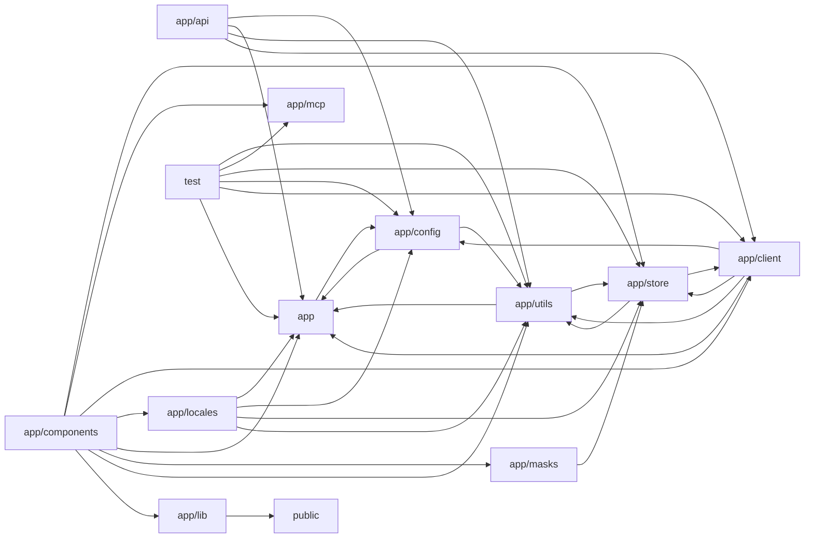

# Architecture

NextChat is a Next.js (App Router) multi-provider LLM chat client. The browser-side app (app/components, app/store, app/client) renders chat sessions, masks (system prompts), plugins/MCP tools, Stability AI image generation, TTS and realtime voice; state is persisted in IndexedDB via Zustand wrappers in app/utils. Requests to LLM providers (OpenAI, Azure, Anthropic, Google, DeepSeek, Baidu, ByteDance, Alibaba, Tencent, Moonshot, iFlytek, xAI, ChatGLM, SiliconFlow, 302.AI) flow from per-provider client adapters in app/client/platforms through edge API route handlers in app/api, which enforce access codes, inject server-held API keys (app/config/server.ts), filter models and optionally route through Cloudflare AI Gateway. Shared constants/types live in app/constant.ts and app/typing.ts; i18n in app/locales; built-in personas in app/masks; MCP server lifecycle in app/mcp. Root config (next.config.mjs) adds reverse-proxy rewrites and CORS; Jest tests in test/ cover utils, model tables, MCP guards and validators.

## Modules

| module | summary | AI |
| --- | --- | --- |
| `(root)` | Next.js build/runtime config (AI provider proxy rewrites, CORS), Jest and Prettier setup. | [AI] |
| `app` | App shell (layout/page), central constants and provider enums, shared types, URL/chat command hooks and client utilities. | [AI] |
| `app/api` | Edge route handlers proxying requests to LLM providers with auth, key injection, model filtering, plus artifacts/WebDAV/Upstash storage endpoints. | [AI] |
| `app/client` | Client-side LLMApi abstraction, ClientApi factory, abort controller pool and per-provider streaming chat adapters. | [AI] |
| `app/components` | React UI: chat, sidebar, settings, masks, plugins, MCP market, markdown/artifacts, SD image generation, TTS and realtime voice chat. | [AI] |
| `app/config` | Build, client and server configuration loaders including provider API keys, access codes and model restrictions. | [AI] |
| `app/lib` | AudioHandler for Web Audio recording, streaming PCM playback and visualization. | — |
| `app/locales` | i18n dictionaries for many languages, language detection/persistence and STT language mappings. | [AI] |
| `app/masks` | Built-in persona/system-prompt presets (en/cn/tw) with runtime store and build export script. | [AI] |
| `app/mcp` | Model Context Protocol server management, tool discovery and execution via server actions and stdio clients. | — |
| `app/store` | Zustand persistent stores for access credentials, chat sessions, config, masks, plugins, prompts, SD tasks, sync and updates. | [AI] |
| `app/utils` | Helpers for SSE streaming/tool orchestration, model table resolution, IndexedDB persistence, cloud sync, TTS, signing and formatting. | [AI] |
| `public` | Browser scripts: service worker file cache on /api/cache and AudioWorklet recorder processor. | — |
| `scripts` | Maintenance script fetching and compiling community prompts into public/prompts.json. | [AI] |
| `test` | Jest unit/integration tests for utils, model tables, MCP guards, validators and config. | [AI] |

## Module dependencies

_`[AI]` marks modules with AI/LLM touchpoints (prompt files, model API calls, agent logic)._
