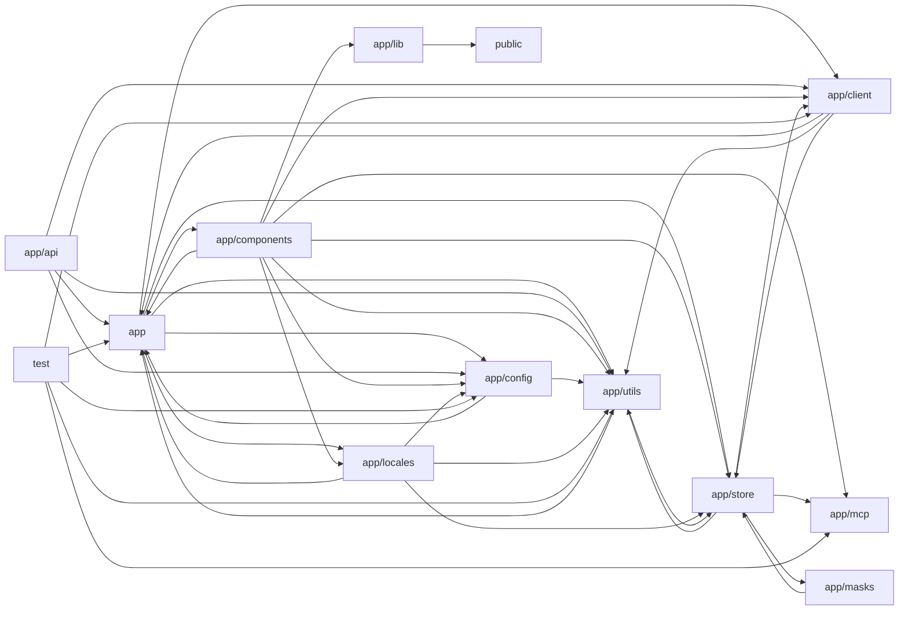

# Architecture

NextChat is a Next.js (App Router) chat client that fronts many LLM providers (OpenAI/Azure, Anthropic, Google Gemini, DeepSeek, Baidu, ByteDance, Alibaba, Tencent, Moonshot, iFlytek, xAI, ChatGLM, SiliconFlow, 302.AI, Stability AI) behind a single abstraction. The browser UI (app/components) drives persisted Zustand stores (app/store) which call a unified client-side LLMApi abstraction (app/client) with per-provider adapters that stream SSE responses via helpers in app/utils. Requests are relayed through edge route handlers in app/api, which authenticate access codes, inject server-side API keys from app/config, filter models, and proxy to upstream providers; next.config.mjs adds additional rewrite-based proxies. Cross-cutting concerns include i18n (app/locales), built-in prompt templates (app/masks, scripts), Model Context Protocol tool integration via server actions (app/mcp), realtime audio pipelines (app/lib, public workers), cloud sync (WebDAV/Upstash), and a Jest unit suite (test) covering utilities, model-resolution rules, crypto helpers, and MCP security guards. Note: API route handlers declare `runtime = 'edge'` while the declared stack says node.

## Modules

| module | summary | AI |
| --- | --- | --- |
| `(root)` | Next.js build/bundling config, Jest setup, Prettier rules, and API proxy rewrites to upstream AI providers. | [AI] |
| `app` | Root layout/page entry points plus shared constants (provider URLs, storage keys), command hooks, message utilities, and core types. | [AI] |
| `app/api` | Edge route handlers that authenticate, filter, and proxy requests to each AI provider, plus artifacts, config, WebDAV and Upstash proxies. | [AI] |
| `app/client` | Client-side LLMApi abstraction, abort-controller pool, and per-provider adapters for chat streaming, image generation, and TTS. | [AI] |
| `app/components` | React UI: chat window, sidebar, settings, masks, plugins/MCP market, exporter, realtime voice chat, Stability AI panels, and UI primitives. | [AI] |
| `app/config` | Build-time, client-side, and server-side configuration parsing including provider credentials, endpoints, and model access flags. | [AI] |
| `app/lib` | Web Audio AudioHandler for microphone capture via AudioWorklet, streaming playback, frequency analysis, and WAV export. | — |
| `app/locales` | i18n dictionaries for many languages, locale detection/switching, fallback merging onto English, and STT language mapping. | [AI] |
| `app/masks` | Built-in prompt templates (CN/TW/EN), in-memory mask store, and build script exporting public/masks.json. | [AI] |
| `app/mcp` | Model Context Protocol server lifecycle, stdio client transports, tool listing/execution, and authenticated Next.js server actions. | — |
| `app/store` | Persisted Zustand stores for chat sessions, access keys, app/model config, masks, prompts, plugins, SD tasks, sync, and updates. | [AI] |
| `app/utils` | Chat streaming/tool-calling orchestration, model catalog parsing, IndexedDB-backed stores, cloud sync clients, TTS, and provider auth signing. | [AI] |
| `public` | AudioWorklet recorder processor and a Service Worker providing a local /api/cache file cache. | — |
| `scripts` | Maintenance script fetching and filtering community prompt templates into public/prompts.json. | [AI] |
| `test` | Jest unit/regression suite for utilities, model resolution rules, HMAC crypto, config parsing, and MCP security controls. | [AI] |

## Module dependencies

_`[AI]` marks modules with AI/LLM touchpoints (prompt files, model API calls, agent logic)._
