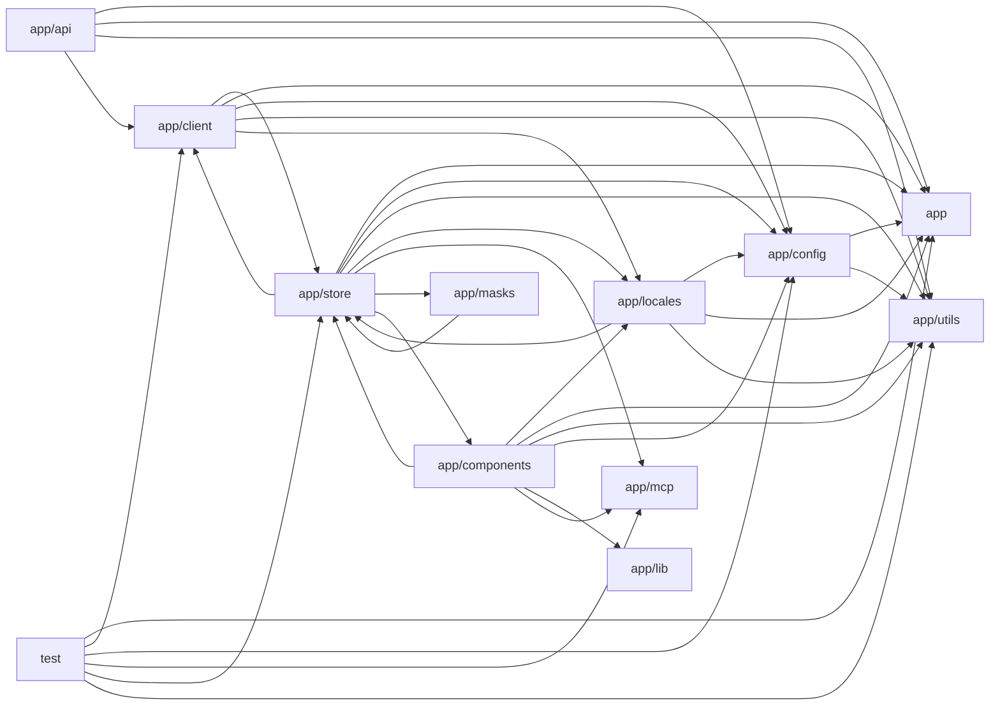

# Architecture

NextChat is a Next.js (App Router) multi-provider LLM chat client. The root config layer (next.config.mjs, jest) sets up build, proxy rewrites to upstream model providers, and testing. The `app` shell supplies layout, constants, typing, and shared utilities. Requests flow from UI components (`app/components`) through Zustand-like persisted stores (`app/store`) to a unified client abstraction (`app/client`, with one LLMApi adapter per provider), which calls Edge route handlers in `app/api` that authenticate access codes, inject server keys, filter models, and proxy to OpenAI, Anthropic, Google, Azure, DeepSeek, Alibaba, Baidu, Tencent, and others. Cross-cutting support comes from `app/config` (env/server/client config), `app/utils` (streaming, tool-call loops, sync, model parsing, persistence), `app/locales` (i18n), `app/masks` (builtin prompt templates), `app/mcp` (Model Context Protocol server lifecycle and tool execution via server actions), and `app/lib` (Web Audio for realtime voice). `public` holds worker scripts, `scripts` builds the prompt library, and `test` covers utilities, model filtering, MCP parsing/authorization, and token estimation.

## Modules

| module | summary | AI |
| --- | --- | --- |
| `(root)` | Build, bundling, formatting, and Jest configuration including proxy rewrites to LLM provider APIs and CORS headers. | [AI] |
| `app` | Application shell, root layout/page, core types, command hooks, provider constants, and shared message/model utilities. | [AI] |
| `app/api` | Edge route handlers and proxy adapters that authenticate, inject keys, filter models, and forward requests to LLM providers plus artifact/WebDAV/Upstash endpoints. | [AI] |
| `app/client` | Abstract LLMApi interface, ClientApi dispatcher, abort-controller pool, and per-provider adapters for chat, streaming, speech, and tool calls. | [AI] |
| `app/components` | React UI: chat window, sidebar, markdown/artifacts, settings, masks, MCP market, plugins, realtime voice chat, and Stable Diffusion panels. | [AI] |
| `app/config` | Build, client (meta-tag hydrated), and server (env var, API key, access code) configuration resolution. | [AI] |
| `app/lib` | Web Audio API handler for microphone PCM recording, streaming playback, spectrum analysis, and WAV export. | — |
| `app/locales` | i18n dictionaries for 20+ languages with fallback merging, language detection, and STT locale mappings. | [AI] |
| `app/masks` | Builtin multilingual prompt templates (masks), build script to masks.json, and runtime builtin mask store. | [AI] |
| `app/mcp` | Model Context Protocol server config/lifecycle via server actions, stdio client wrapper, Zod types, and MCP code-block parsing. | — |
| `app/store` | Persisted client state stores for access credentials, chat sessions, config, masks, plugins, prompts, SD tasks, sync, and updates. | [AI] |
| `app/utils` | Streaming/tool-call orchestration, persistence wrappers, sync/merge, model list parsing, provider signatures, TTS, and media helpers. | [AI] |
| `public` | Static audio worklet processor and service worker for /api/cache file caching. | — |
| `scripts` | Fetches community prompt datasets and writes public/prompts.json. | [AI] |
| `test` | Jest unit tests for utilities, model filtering, MCP parsing/authorization, hashing, config validation, and token estimation. | [AI] |

## Module dependencies

_`[AI]` marks modules with AI/LLM touchpoints (prompt files, model API calls, agent logic)._
